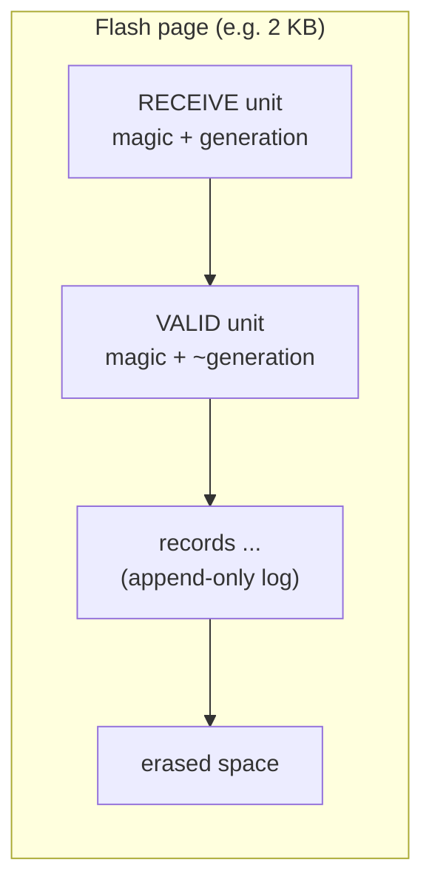
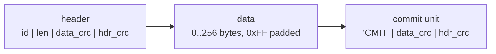
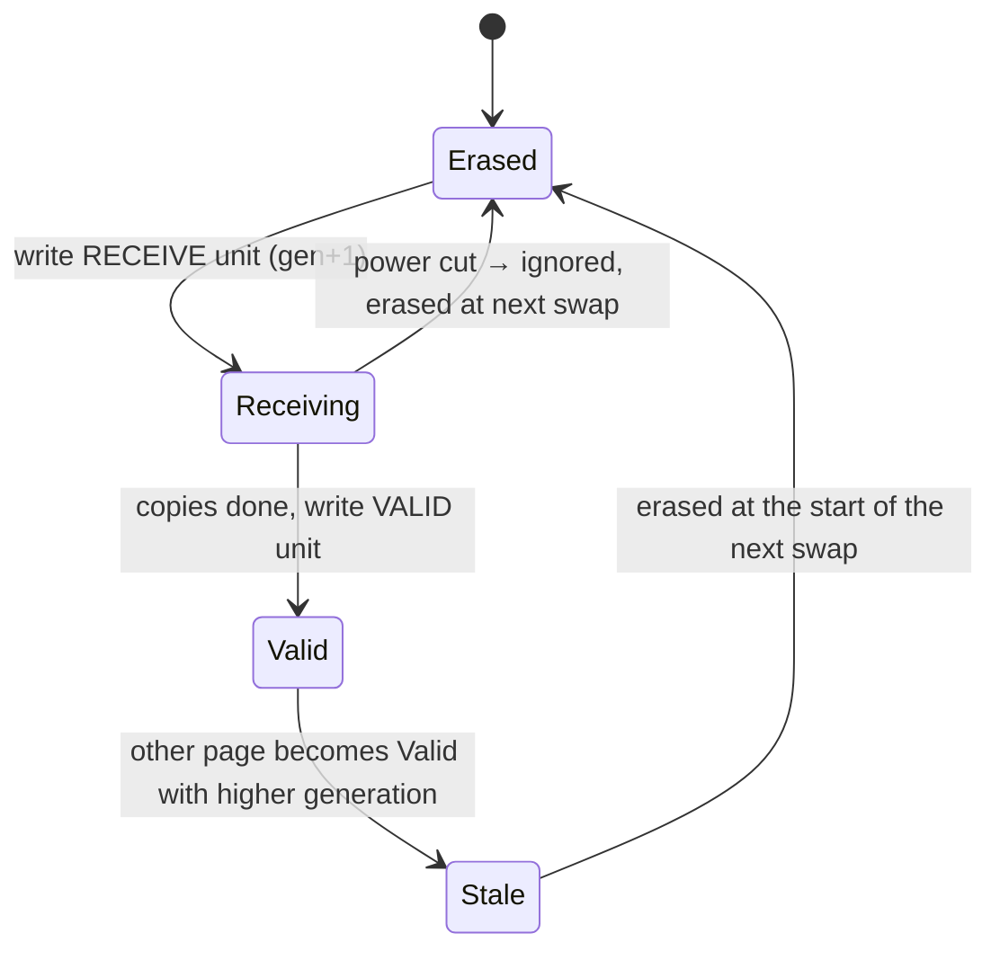

# Flash EEPROM Emulation (power-loss safe)


A small C11 library that stores key/value data in on-chip NOR flash as if it were an EEPROM —
**safe against power loss at any instant**. Every value is either the old one or the new one
after a reset, never a mix, and no flash unit is ever programmed twice between erases.

Written for microcontrollers such as STM32L4/G4 (8-byte program unit with ECC), with a host
simulator that cuts the power in the middle of programs and erases to prove the claims.

## Features

- Key/value API: `ee_write`, `ee_read`, `ee_delete` (ids 0x0000–0xFFFE, values 1–256 bytes)
- Two-page log with garbage collection; one page erase per swap, blank pages are never re-erased
- Atomic updates: each record ends with a **commit unit** that must match exactly
- Unchanged values are not written again (saves flash endurance)
- CRC-16 on every record to detect data that changed after it was written
- No dynamic memory, no globals: everything lives in an `ee_t` instance
- Portable flash driver interface (`read` / `program` / `erase_page`), example STM32L4 port
- Built with `-Wall -Wextra -Wpedantic -Wconversion -Wsign-conversion -Werror`; CI with gcc,
  clang, AddressSanitizer/UBSan and cppcheck

## Quick start

```c
#include "ee/eeprom_emul.h"

static ee_t ee;

void settings_example(const ee_config_t *flash_cfg)
{
    uint32_t boot_count = 0u;

    if (ee_init(&ee, flash_cfg) != EE_OK) {
        return;                                  /* flash driver failure */
    }
    (void)ee_read(&ee, 1u, &boot_count, sizeof boot_count, NULL);   /* EE_ERR_NOT_FOUND on first boot */
    boot_count++;
    (void)ee_write(&ee, 1u, &boot_count, sizeof boot_count);
}
```

The flash driver is three functions plus two page addresses — see
[`examples/stm32l4/ee_port_stm32l4.c`](examples/stm32l4/ee_port_stm32l4.c).

## Design





- **Write:** append a record to the active page: header → data → commit unit (written last).
- **Read:** a RAM index (id → offset) built at `ee_init` points to the latest committed record;
  the CRC is checked on every read.
- **Page swap (garbage collection):** when the active page is full, the other page is erased
  (only if not blank), marked RECEIVE with `generation + 1`, the latest value of every id is
  copied, the new value is added, and the page is marked VALID. That single unit write is the
  commit point of the swap. The old page stays as it is until the next swap needs it.
- **Mount:** of the pages with a valid RECEIVE + VALID pair the higher generation wins; its
  log is scanned, uncommitted records are skipped, a damaged header ends the log and forces a
  swap on the next write.



More detail and the reasoning behind each choice: [docs/DESIGN.md](docs/DESIGN.md).

## Power-loss safety

| Power cut during … | State after reset | Result |
|---|---|---|
| record header | header CRC fails → end of log, next write swaps pages | old value |
| record data | commit unit missing → record skipped | old value |
| commit unit | partly programmed → no exact match → skipped | old value |
| erase at the start of a swap | that page is not valid → ignored | all old values |
| copies into the new page | new page has no VALID unit → ignored | all old values |
| VALID unit of the new page | partly programmed → not valid → old page used | all old values |
| after the VALID unit | new page has the higher generation | all new values |

### Test results

`powercut_stress` performs random writes and deletes on 24 ids (1–64 bytes, 2 KB pages) and
cuts the power on every 4th operation — half of the cuts inside a record write, half inside a
page swap. A partly programmed unit has a random subset of its bits cleared; a partly erased
page has a random subset of its bits set. After every cut the device is re-mounted and **every**
id is compared with a RAM model.

| Seed | Operations | Power cuts | … in page swap | … in erase | Page swaps | Result |
|---:|---:|---:|---:|---:|---:|---|
| 42 | 1,000,000 | 70,927 | 11,235 | 738 | 54,368 | pass |
| 7 | 1,000,000 | 70,834 | 10,945 | 680 | 54,554 | pass |
| 1234 | 1,000,000 | 70,975 | 11,074 | 734 | 54,233 | pass |
| 99 | 1,000,000 | 70,744 | 11,005 | 715 | 54,328 | pass |
| 2026 | 1,000,000 | 70,923 | 11,198 | 690 | 54,347 | pass |
| 777 | 5,000,000 | 353,440 | 55,738 | 3,505 | 271,565 | pass |

No lost or mixed value and no second program of a unit in 10 million operations and ~707,000
power cuts. 15 unit tests (328 checks) cover the API, page swaps, full page, full key table,
damaged log tail, interrupted commit and corrupted data.

## Endurance

Each page swap costs one erase. Writes per swap ≈ `(page_size − 16 − live_bytes) / record_size`,
where `record_size = 16 + value length rounded up to 8`.

Example: 2 KB pages, 8 values of 16 bytes (record 32 B, live data 256 B) → about 55 writes per
swap. With two pages of 10,000 erase cycles (check your device datasheet) that is about
20,000 × 55 ≈ **1.1 million writes**. Fewer or smaller live values give more writes per erase.

## Build and test

```sh
cmake -S . -B build -G Ninja
cmake --build build
ctest --test-dir build --output-on-failure
./build/powercut_stress 1000000 42        # operations, seed
```

Options: `-DEE_SANITIZE=ON` (gcc/clang, Linux), `-DEE_MAX_KEYS=…` / `-DEE_MAX_DATA=…` through
`CMAKE_C_FLAGS` to change the limits.

## Porting

Provide `read`, `program` (aligned, multiple of 8 bytes) and `erase_page` for two flash pages
and pass them in `ee_config_t`. If your flash has a different program unit, change
`EE_UNIT_SIZE`. The STM32L4 example also explains the ECC double-error NMI that a real port
must handle when it reads a unit whose programming was interrupted.

## Limitations and next steps

- Not thread-safe: call it from one context, or wrap it in a mutex.
- All live values together must fit one page (`EE_ERR_FULL` otherwise).
- Two pages only; more pages would spread wear further.
- The STM32L4 port is an example and still needs the ECC NMI handling and a hardware test.

## License

MIT — see [LICENSE](LICENSE).
